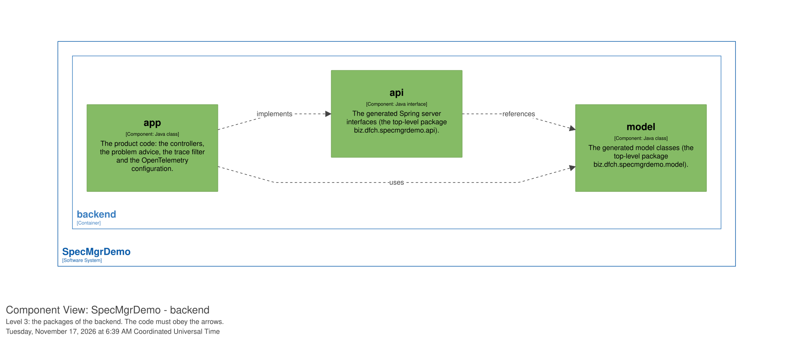
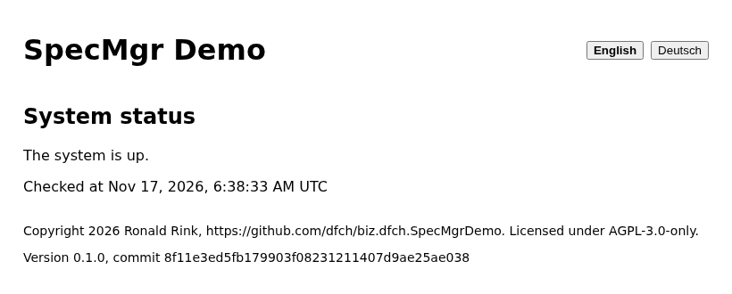
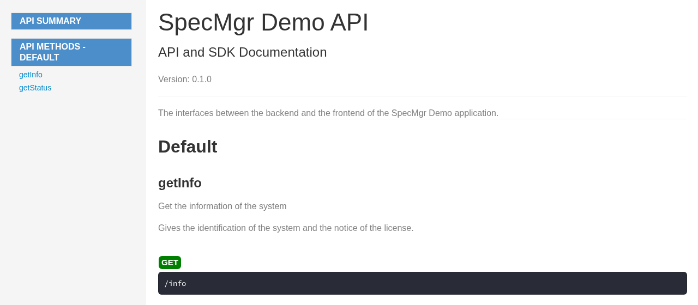

# Specs the build enforces

**SpecMgrDemo: specmgr + autonomous coding, with gates**

Ronald Rink - technical presentation for the head of development

- The product code is a placeholder (one operation: `GET /status`). **The policies, the standards and the gates are the product.**
- Work in progress: this talk shows what runs today, and what does not yet.

**Where it differs from typical "spec frameworks"** (my judgement, not a check of their current versions): they produce markdown specs and rely on the agent to follow them. Here **a CI gate checks the link from spec to code**, and the rules for agents are recorded decisions with an owner.

---

## 1. One chain, checked by a gate

`GOL -> REQ -> SYSRS -> VCR -> test -> OpenAPI -> model`, all by **specmgr UUID** (DEC `f21920d2`)

| Link | Example (`GET /info`, feat-9 branch) |
|---|---|
| REQ (EARS: "WHEN ... THE system must ...") | `271168a4-...` |
| VCR (`## Verifies` the REQ) | `eb8a7f16-...` |
| Test title | `vcr:eb8a7f16-... the operation gives the identification and the license` |
| OpenAPI | `x-specmgr-req: 271168a4-...` on `GET /info` |
| Model element | property `specmgr-req` on component `api` |

`just traceability` (733 lines, 32 fixture cases): **error** if an approved REQ has no VCR, a `vcr:` id has no document, or a reference has no target. The id is a UUID, so it survives renames.

Status: the gate is done and merged. feat-9 is the first feature that fills the chain end to end (VCRs still `draft` at the time of writing).

---

## 2. Gates that fail closed, and are tested

- **27 CI jobs**, each exactly `just <recipe>`. `check_workflows` rejects any other form (no `env`, `needs`, `continue-on-error`).
- A missing gate script gives "NOT IMPLEMENTED", never a pass. An empty SBOM is a failure.
- **The gates have tests:** 1148 self-test cases on the feat-9 branch (good and bad fixtures). `Broken*` rules must fail and name the violation.
- **Breaking changes** (oasdiff) need an ignore line **and** a version bump.

- **Supply chain:** actions pinned to a full SHA, hash-locked Python tools, pnpm lock files, sha256 for binaries and Maven plug-ins. Known limit stated openly: Maven plug-in dependencies (issue #23).
- **Libraries:** licence classes in DEC `84c37f7d`. `license-check` reads the CycloneDX SBOM and fails closed on unknown licences. An exception needs a dated owner entry (DEC `93a6d588`).
- **Real example:** OSV found 2 Critical findings in Spring 6.2.19 with no fix on that line. The agent stopped, the owner decided, the project moved to Spring Boot 4.0.9.

---

## 3. Architecture is a checked contract, not a diagram

- Structurizr model with **context, container and component views**. Elements carry `code.*` (where the code is) and `specmgr-req`.
- Rules **derive from the model** (closed world): no arrow means a forbidden dependency. Backend: **3 ArchUnit rules**, frontend: **41 ArchUniTS rules**. Demo: add one forbidden import, the generated rule fails and names it.
- Today the repo also has hand-written rules and a model-vs-code comparison. The DSL and the generator are a demo slice (feat-0). DSL as the source of the repo is planned (feat-50). A model generated from REQs is **not** built.

---

## 4. Agents with boundaries, on a running system

- **Limits as decisions** (DEC `cc4449cd`): an agent must not accept a DEC, lower a threshold, disable a gate, or add a dependency without a licence check. CODEOWNERS covers DECs, workflows, `justfile`, `tools/`.
- **Orchestrator** (cannot edit, cannot push) runs one fresh **implementer** per phase and re-runs the gates itself. Reviewer agents list findings with file and line.
- **Plans are the memory:** phases, tasks, owner decisions with dates, handover notes.
- Tool output is untrusted: the jqwik jar prints text that tells AI agents to ignore results. It is recorded, and agents ignore it.

The walking skeleton: React UI (EN/DE), `GET /status`, `GET /info`, API docs from `contracts/openapi.yaml`.

---

## 5. Honest status

| Done and merged | In progress or planned |
|---|---|
| Traceability gate, security reports (OSV, gitleaks, zizmor, CodeQL) | feat-9 walking skeleton: phases 100-400 on a branch, security thresholds not started |
| Contract pipeline, breaking-change policy | feat-50 model as DSL source and generic rules (plan only) |
| Pins, licence gate, SBOM, tested gates | feat-48 pre-commit hooks (plan only) |
| 20 DECs, 4 SOPs, all validated by `specmgr lint` | ASD-STE100 check (on hold by owner decision) |

**Weak points, stated plainly**
- Thin demo on `dev`: **one REQ**, one operation. Coverage and mutation score are low (backend line coverage 12%, PIT 5.8% on `dev`), **no thresholds**. Security findings do not block yet.
- Agent boundaries are **not machine-enforced** (agents use the owner's token). No `AGENTS.md` or opencode config in the repo. The agent prompts still name gates of a sibling repo.
- Rulesets live in GitHub settings, not in git. No release or tag yet. No legal review of the licence entries.
